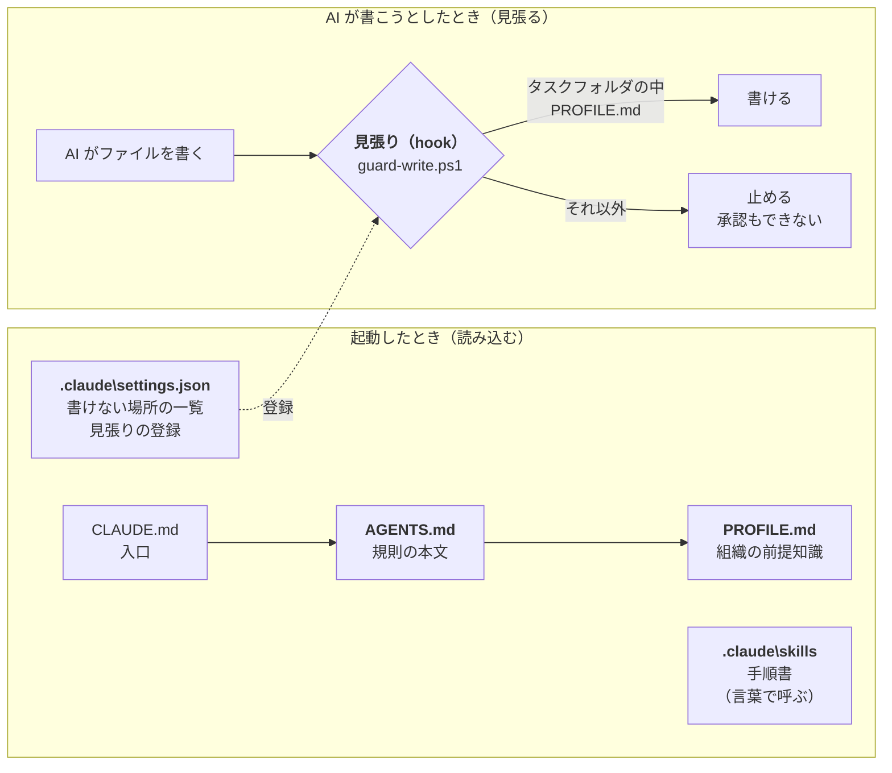

# AI-DESK勉強会

[概要](../概要) ｜ [インストール](../インストール) ｜ [使い方](../使い方) ｜ [困ったとき](../困ったとき)

## 目的・内容
- AI-DESKを設定し、使い方を練習する。
- 環境は、Windows 上の ClaudeアプリでClaude Codeを用いる。
- デスクトップに "AI-DESK" という名前でインストールし、練習を行う。

## 用意するもの
- Windows 10 / 11 の PC
- Claudeアプリ（インストールし、ログインしておく）

## インストール(設定)
- Claudeアプリを起動 \
  (1) Code を選択、(2) このコンピュータ、(3) フォルダなし（もしくは任意のフォルダ） \
\
    
- 以下のように入力
  ```
  https://github.com/nofukao/AI-DESK の README の手順どおり、bin\new-instance.ps1 で AI-DESK を作成してください。
  場所 : デスクトップ
  フォルダ名 : AI-DESK
  リポジトリは一時的な場所に取得してください。デスクトップに直接 clone しないでください。
  ```

## 起動、初期設定
- Claudeアプリを起動 \
  上記の (1)(2) のあと、(3) で「フォルダを開く…」を選び、デスクトップの AI-DESK を選択 \
\
  
- 初回に出る「このワークスペース(フォルダ)を信頼しますか」で、必ず承諾。 \
  （断ると、書き込みの制限が動かない。承諾できたかは、あとの疎通確認の 8-4 で分かる）
- プロンプトで「**初期設定**」と入力。 (対話で PROFILE.md を作る。) \
  途中で英語で「この先も読み続けてよいか」と聞かれたら、**Keep allowing** を選ぶ。
  **Block from now on** は選ばない（以後、AI-DESK の外の資料を読めなくなる）。
- プロンプトで「**疎通確認**」と入力。 (環境の点検。特に、書き込みの制限が効いているか。) \
  途中で「わざと間違った場所へ書き込もうとします」と言われる。**止められるのが正しい動作。** 確認が出たら「いいえ」。 \
  版の比較が「確認できませんでした」と出ても異常ではない（作るときに使った一時フォルダが消えると、こうなる）。
- うまくいかないときは → [困ったとき](../困ったとき)

[初期設定と疎通確認の実行例](./init_prompt)（版 1.5.0 のときの記録）

## 実行例

## AI-DESKの仕組み解説

AI-DESK の約束は1つです。

> **資料は自由に読めるが、書けるのは自分の机の上（タスクフォルダ）だけ。**

AI-DESK は、この約束を AI の心がけだけに任せず、**Claude Code の設定ファイルで機械的に守らせています。** \
ここでは、さきほど作った AI-DESK のフォルダの中で、何がその役目を果たしているかを見ます。

### 全体像



- 起動すると、Claude Code は `CLAUDE.md` を読みます。中身は「`AGENTS.md` を読め」の1行で、**規則の本文は `AGENTS.md` にあります。**
  `PROFILE.md` は、`AGENTS.md` の中から読み込まれます
- `.claude\settings.json` で、**見張り役のスクリプト（hook）**が登録されます。
  AI がファイルを書く直前に、**毎回** hook が書き込み先を調べ、決まった場所でなければ止めます
- 「初期設定」「疎通確認」のような言葉で呼ぶと、`.claude\skills\` の手順書（スキル）が読み込まれ、AI はその手順どおりに動きます

### 設定ファイルの役割

AI-DESK のフォルダの中身です。 (**赤字**は、Claude Codeで最初から定義されているもの)

| ファイル・フォルダ | 役割 | AI が書けるか |
|---|---|---|
| **`AGENTS.md`** | AI-DESK の規則の本文。 書く場所と名前、Git を使わない、削除しない など | 書けない |
| **`CLAUDE.md`**・`GEMINI.md` | 規則への入口（Claude Code 用・Antigravity 用）。中身は「`AGENTS.md` を読め」だけ | 書けない |
| `PROFILE.md` | この組織の前提知識。 業態・社内の言葉・資料の場所。「初期設定」で作った | 書ける（人が直してもよい） |
| `README.md` | 人向けの案内 | 書けない |
| **`.claude\settings.json`** | Claude Code の設定。書けない場所の一覧（deny）、見張り（hook）の登録、AI の自動メモリを切る（覚えさせたいことは `PROFILE.md` に書く） | 書けない |
| `.claude\hooks\guard-write.ps1` | 見張り役。 書き込み先を調べて、決まった場所以外を止める | 書けない |
| **`.claude\skills\`** | 手順書（スキル）。配布物には「初期設定」「疎通確認」「新規タスク」「継続タスク」の4つ | 承諾を得てから足せる |
| `.ai-desk\VERSION` | 版番号。ここが AI-DESK だという目印（フォルダ名ではなく、これで見分ける） | 書けない |
| `.ai-desk\source.txt` | どこからコピーして作ったか（配布元）。版の比較に使う | 書けない |
| `bin\` | Python を入れる、履歴の一覧を直す などのスクリプト | 書けない |
| `00_タスクテンプレート\` | 込み入った依頼を書くときのひな形 | 書けない |
| `_保管庫\` | 古いタスクフォルダの置き場（移すのは人） | 中のタスクフォルダには書ける |
| `<タスクフォルダ>\` | 依頼1件につき1つ。AI が書けるのは、ここだけ（人が書く `00_TASK.md` は除く） | 書ける |

歯止めは3つ。

| 歯止め | 何を止めるか | 強さ |
|---|---|---|
| **見張り（hook）** | AI-DESK の外・資料フォルダ・ルート直下・配布物・`00_TASK.md` への書き込み | 機械的に止まる。**承認もできない** |
| **書けない場所の一覧（deny）** | 規則・設定ファイル・`00_TASK.md` への書き込み、削除・移動・git のコマンド | 機械的に止まる（hook が動かなかったときの2枚目の壁） |
| **AI への規則（`AGENTS.md`）** | 別のタスクフォルダへの書き込み、置いた資料の書き換え、読ませない場所を開くこと | AI への約束 |

詳しくは → [概要](../概要) の「3. 安全の仕組み」

### 疎通確認 と 初期設定

#### 初期設定 — PROFILE.md を作った

スキル「初期設定」の手順で、AI が質問しながら `PROFILE.md` を作りました。

| 何をしたか | なぜ |
|---|---|
| 質問を**1つずつ**、8つ（業態・頼みたい仕事・社内の言葉・資料の場所・読ませない場所・名前の付け方・場所の変更・毎回の注意） | 社内の言葉（略語・呼び名）は、AI が資料を読み違える最大の原因だから |
| 資料の場所は、ドライブの**フォルダ名だけ**を一覧し、下書きの表を見せて確かめた | パスを打たせないため。**ファイルの中身は開いていない** |
| AI が推測したことは「未確認」と書いた | 推測を事実として扱わないため |
| 「AI に読ませない場所」は、あれば書く | AI への約束です。**機械的に読めなくする設定ではありません** |

- できたもの: `<AI-DESK>\PROFILE.md`（AI が書けるルート直下のファイルは、これだけです）
- `PROFILE.md` は、**次の起動から毎回自動で読み込まれます。** 会社の説明を毎回しなくて済みます
- 足りないと気づいたら、「**PROFILE に足して**」と言えば足せます。自分で直しても構いません
- `PROFILE.md` は、この AI-DESK だけのものです。配布されず、GitHub にも送られません

#### 疎通確認 — 環境を点検した

スキル「疎通確認」の手順で、AI が次の項目を上から順に確かめました。
**読むだけ・調べるだけの確認がほとんどで、** 書き込むのは点検用のフォルダ `00_疎通確認\` だけです。

| 分類 | 項目 | 何を確かめるか |
|---|---|---|
| 場所と版 | 1・1-2・2 | ここが AI-DESK か（`.ai-desk\VERSION`）、Windows か、配布元より古くないか |
| 規則と知識 | 3・4・5 | 規則（`AGENTS.md`）が読み込まれているか、`PROFILE.md` の状態、スキルが使えるか |
| 読めるか | 6・7 | 資料のフォルダのファイル名を一覧できるか（中身は開かない）、Python（`py`）が使えるか |
| 書けるか・書けないか | 8-1〜8-4 | 見張りの仕組みが揃っているか、タスクフォルダに**書けるか**、決まった場所以外は**止められるか** |
| 構成 | 9 | 必要なファイルが揃っているか、**`.git` が無いか** |
| 履歴 | 10 | 会話の履歴の一覧が出るか（ネットワークドライブに置いたとき） |

**いちばん大事なのは 8 です。** AI はここで、わざと間違った場所へ書き込もうとします。

| 試験 | 書こうとする場所 | 止めるもの | 正しい結果 |
|---|---|---|---|
| 8-2 | `00_疎通確認\00_点検記録.md`（タスクフォルダ） | — | **書ける** |
| 8-3 | `00_タスクテンプレート\点検.txt`（配布物） | 書けない場所の一覧（deny） | **止められる** |
| 8-4 | ルート直下の `点検メモ.md` | 見張り（hook）だけ | **止められる** |

- 8-3 と 8-4 は、**壁を1枚ずつ**試しています。8-4 の場所は deny に挙げていないので、止まるとすれば hook の働きです
- **8-4 で書けてしまったら、hook が動いていません。** まず「信頼しますか」を承諾したかを疑います
- できたもの: `<AI-DESK>\00_疎通確認\00_点検記録.md`（点検のたびに上書きされます）
- **いつ使うか**: 作った直後、新しい版に更新したあと、「読めない」「書けない」など調子がおかしいとき

実際のやりとりは → [実行例](./init_prompt) の第1部（初期設定）・第2部（疎通確認）
