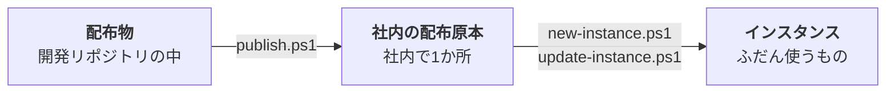

[概要](/repos/AI-DESK-DEV/概要) ｜ [インストール](/repos/AI-DESK-DEV/インストール) ｜ [使い方](/repos/AI-DESK-DEV/使い方) ｜ [困ったとき](/repos/AI-DESK-DEV/困ったとき)

この文書は AI-DESK **1.5.0** の時点のものです。

---

## 1. AI-DESK とは

**手元の資料を AI（Claude Code）に読ませて、まとめ・議事録・比較表などを作ってもらうための作業場**です。
Windows のフォルダ1つが、AI-DESK 1つです。フォルダごとコピーして、どこにでも置けます。

名前の由来は「机（デスク）」です。

> **資料は書庫から自由に持ってきて読めるが、書けるのは自分の机の上だけ。**

これが AI-DESK のいちばん大事な約束です。AI は資料を読めますが、
**書き込めるのは、いま取り組んでいる依頼のフォルダの中だけ**に制限してあります。

---

## 2. できること

- **話しかけるだけで頼めます。** 「この資料から議事録を作って」と言えば、AI が依頼用のフォルダを作り、その中に結果を出します
- **依頼1件につき、フォルダが1つ**できます。これを **タスクフォルダ** と呼びます
- **何回でも続けられます。** 「〜の続き」と言えば、前回までの経緯を読んで、途中から再開します
- **前の結果は消えません。** 「短くして」と頼んでも、結果は別のファイルになります
- **組織の前提知識を覚えさせられます。** 業態・社内の言葉・資料の置き場所を `PROFILE.md` に書いておくと、毎回説明しなくて済みます
- **Excel・Word・PowerPoint・PDF も読めます**（Python を使います。無ければ、承諾を得てから AI が入れます）

---

## 3. 安全の仕組み

AI-DESK は、確認を出さずに作業を進める「Auto」モードで使う前提で作ってあります。
そのぶん、**歯止めは確認画面ではなく、設定そのもの**に置いてあります。

| 歯止め | 何を止めるか | 強さ |
|---|---|---|
| **書き込みの制限**（hook） | AI-DESK の外、資料フォルダ、ルート直下、`00_TASK.md`（人が書く依頼）への書き込み | **機械的に止まる。** 承認もできない |
| **設定の拒否リスト**（deny） | 規則のファイル・設定ファイル・`00_TASK.md` への書き込み | 機械的に止まる（hook が動かなかったときの2枚目の壁） |
| **AI への規則**（`CLAUDE.md`） | 別のタスクフォルダへの書き込み、タスクフォルダに置いた資料の書き換え、読ませない場所を開くこと | AI への約束 |

**止めきれないものもあります。** AI が作ったプログラム（Python など）が書き出すファイルは、
設定の制限では見張れません。AI には、書き出し先を実行前に必ず確かめる規則を課しています。
**AI は、作ったファイルの場所を毎回フルパスで報告します。** タスクフォルダ以外の場所が書かれていたら、その場で伝えてください。

そのほかに、次のことを決めてあります。

- **AI-DESK の中で Git を使いません。** 業務の資料が、誤って外部のサービスへ出るのを防ぐためです
- **業務の内容を、Web 検索や外部のサービスへ送りません**
- **AI はファイルの削除・移動・改名をしません。** 間違えたときは、何をどこに作ったかを報告して、指示を待ちます

---

## 4. 全体の構成

AI-DESK は、**開発リポジトリ**で作った**配布物**を、コピーして使います。コピー1つ1つを **インスタンス** と呼びます。



- 開発リポジトリ（`AI-DESK-DEV`、Git で管理）の中の `AI-DESK\` フォルダが配布物（ひな形）です
- `publish.ps1` は管理者が実行します。インスタンスは `new-instance.ps1` で作り、`update-instance.ps1` で新しい版にします
- 配布原本を通さずに、開発リポジトリから `new-instance.ps1` で直接作ることもできます

インスタンスの中は、次のようになっています。

```
AI-DESK\
    CLAUDE.md              AI-DESK の規則（AI が読む。直さない）
    README.md              人向けの案内
    PROFILE.md             この組織の前提知識（「初期設定」で作る）
    .ai-desk\VERSION       版番号。ここが AI-DESK の入口だという目印
    .claude\               書き込みの制限と、手順（スキル）
    bin\                   Python の導入などのスクリプト
    00_タスクテンプレート\   込み入った依頼を書くときのひな形
    _保管庫\               古いタスクフォルダの置き場
    差出人名簿\             ← タスクフォルダ（依頼1件）。AI が書けるのはこの中だけ
        00_作業記録.md      これまでの経緯
        01A_依頼内容.md     1回目に頼んだこと
        01B_差出人名簿_2026-09-16.xlsx   1回目の成果物
        材料\              AI が使った道具・途中のデータ
```

**AI-DESK かどうかは、フォルダ名ではなく `.ai-desk\VERSION` があるかで決まります。**
フォルダ名は自由で、同じ PC・同じ共有フォルダに、いくつ置いても構いません。

---

## 5. 動作環境

| 項目 | 必要なもの |
|---|---|
| OS | **Windows 10 / 11 だけ**。macOS・Linux では書き込みの制限が動かないため、使えません |
| AI | **Claude Code**（VS Code の拡張機能、またはターミナル）。Antigravity も規則を読みますが、書き込みの制限は効きません |
| PowerShell | Windows に入っている 5.1 で動きます |
| Python | Office・PDF の資料を読むときに使います。無ければ、AI が承諾を得てから入れます（管理者権限は不要） |
| Git | 利用者は不要です（開発リポジトリだけで使います） |

---

## 6. 版と変更履歴

版番号は、インスタンスの `.ai-desk\VERSION` にあります。AI に「**疎通確認**」と言うと、版番号と、配布元より古くないかを教えてくれます。
変更の中身は、開発リポジトリの `CHANGELOG.md` にあります。

---

## 7. 開発リポジトリは GitHub で管理しています

開発リポジトリ `AI-DESK-DEV` は、GitHub の **[nofukao/AI-DESK](https://github.com/nofukao/AI-DESK)** で管理しています（GitHub 上の名前は `AI-DESK` です）。
**公開（Public）のリポジトリ**なので、誰でも中を見られます。

- 入っているのは、配布物（`AI-DESK\`）、インスタンスを作る・更新するスクリプト（`bin\`）、設計の記録、この説明書の原稿です
- **組織の前提知識（`PROFILE.md`）と業務の資料は入っていません。** どちらもインスタンスの中にだけあり、インスタンスでは Git を使わないので、GitHub に送られることはありません
- 変更履歴は [CHANGELOG.md](https://github.com/nofukao/AI-DESK/blob/main/CHANGELOG.md) で見られます
- ライセンスは MIT です
- GitHub での不具合の報告（Issue）は受け付けていません。気づいたことは管理者に伝えてください

次は → [インストール](/repos/AI-DESK-DEV/インストール)
